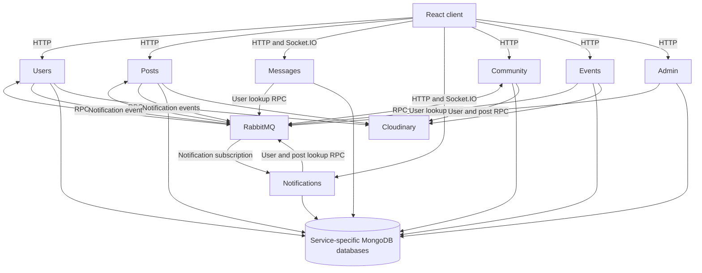

# ZORO — social networking for bikers

A portfolio case study in building a social application across multiple Node.js services. ZORO brings profiles, posts, communities, events, messaging and notifications into a React interface for bikers.

**Status:** implemented application code with Docker Compose, Kubernetes and deployment workflow configuration. Local integration and security work remain; configuration files are not evidence of a successful Kubernetes deployment. The listed Vercel demo returned 404 on 18 October 2026, so no working demo is advertised here.

## Features represented in the implementation

- Registration, OTP verification, sign-in, profiles and follow relationships.
- Social posts, media uploads, comments, likes and saved posts.
- Community discovery and membership; event creation and invitations.
- Direct and group chat, message history, typing events and video-call signaling. The client includes a ZEGOCLOUD video-call integration that requires separate configuration and security review.
- Notifications and unread-notification handling.
- Administrator user and post management.

Feature code is present; this list does not assert that all workflows currently pass end-to-end tests.

## Service boundaries

| Directory | Responsibility | Local port | Database suffix |
| --- | --- | --- | --- |
| `users/` | Accounts, profiles, follow relationships and user lookup RPC | 8001 | `zoro_users` |
| `posts/` | Posts, comments, likes and post lookup RPC | 8002 | `zoro_posts` |
| `notification/` | Consumes notification events, persists notifications and exposes real-time delivery | 8003 | `zoro_notifications` |
| `messages/` | Chats, groups, messages and Socket.IO signaling | 8004 | `zoro_messages` |
| `community/` | Communities and community lookup RPC | 8005 | `zoro_community` |
| `events/` | Events, invitations and creator information | 8006 | `zoro_event` |
| `admin/` | Admin authentication and moderation through user/post RPC | 8080 | `zoro_admin` |
| `client/` | React/Vite UI, Redux Toolkit and API clients | 5173 | — |

Each backend follows `api → services → database/repository`, with Mongoose models and shared-within-service utility functions. Packages and lockfiles are separate; this is not an npm workspace.

## Architecture



### Communication and trade-offs

RabbitMQ carries both request/reply calls and notification events. RPC helpers use reply queues and correlation IDs; callers include profile enrichment, community/post lookup and admin moderation. This keeps ownership in the relevant service, but a request can still depend synchronously on another service and the broker. Timeout handling and channel lifecycle need stronger failure tests.

Users and posts publish events to a direct exchange for the notification service. Its subscription uses an exclusive queue with automatic acknowledgements. That implementation is not a durable, replayable event log; disconnected consumers can miss events. Some channel setup calls assert a queue where an exchange is intended, making startup order another integration concern.

Separate databases make service data ownership visible, but cross-service consistency is an application responsibility. No distributed transaction or exactly-once processing guarantee is claimed.

### Real-time messaging

Messages are persisted through HTTP/service methods. Socket.IO namespaces `/api/message` and `/api/notification` handle chat-room events, typing, video-call signals and notification updates. Socket handlers currently accept client-supplied user/room identifiers; authenticated HTTP routes do not automatically secure socket connections. Room membership and event authorization need hardening before handling private conversations.

### Authentication and storage

User passwords use bcrypt. JWTs are signed with `JWT_SECRET` and accepted through cookies or an Authorization header. Cookie behavior depends on the project's `NODE_ENV=dev` / `prod` convention. Admin authentication is separate. Review authorization at each resource boundary rather than assuming a valid token permits every operation.

MongoDB stores application records. Cloudinary utilities handle media in users, posts, communities and events. AWS-related configuration names also exist, but configuration alone is not evidence of a working S3 media pipeline.

## Local development

Prerequisites: Node.js/npm compatible with the committed lockfiles, MongoDB, RabbitMQ, and Cloudinary test credentials for media flows. Use disposable data and your own integration credentials. There is no root install command.

1. Clone this repository.
2. In each backend directory, copy `.env.example` to `.env.dev` for `npm run dev`, or `.env` for `npm start` and Compose. Set the service port from the table above.
3. Set `MONGODB_URI` to a base URI ending in `/`, for example `mongodb://127.0.0.1:27017/`. The current configuration appends the service database name directly; do not append connection query parameters to this prefix.
4. Use the same local JWT signing secret across services that verify user tokens, and matching RabbitMQ connection/exchange values.
5. In `client/src/constants/constant.js`, select local API origins using the port table. The committed active URLs target an unavailable hosted domain. Socket origins derive from these constants; check any additional direct URLs before testing.
6. Run each backend and the client in separate terminals:

```bash
# Example: users service, from the repository root
cd users
npm ci
npm run dev
```

```bash
# From the repository root, in another terminal
cd client
npm ci
npm run dev
```

Repeat the backend commands for posts, notification, messages, community, events and admin. Start notification before exercising event publishers so its exchange declaration exists. The integration issues below still apply; these are setup instructions, not a claim of a verified clean startup.

### Environment configuration

Backend examples include `PORT`, `MONGODB_URI`, `JWT_SECRET`, `MSG_QUEUE_URL` and `EXCHANGE_NAME`. Media services also read `CLOUD_NAME`, `API_KEY` and `API_SECRET`. Posts/messages expose AWS-related configuration fields, which should remain unset unless you establish an actual supported integration.

The users email utility still contains embedded SMTP credentials rather than environment-based mail configuration. Revoke those credentials and replace the mail configuration before using registration email. Do not reuse any committed credential. Provider settings in the video-call client also need review before enabling that integration.

### Docker Compose

`docker-compose.yaml` builds eight containers and maps the ports above. It does **not** provision MongoDB or RabbitMQ. Supply reachable external development instances and each service's `.env` file first. A container's `localhost` refers to itself; use a reachable database/broker host, such as `host.docker.internal` on Docker Desktop when appropriate.

```bash
docker compose config --quiet
docker compose up --build
```

The client is built into an Nginx image and served at `http://localhost:5173`. API constants must be corrected before that build. The client Compose entry currently references `users/.env`, which does not configure Vite's compiled API constants. Do not treat this file as a turnkey production deployment.

### Kubernetes and Skaffold

`k8s/stateless/` contains Deployments/Services; `k8s/ingress/` and `k8s/ssl/` contain ingress and certificate configuration. `skaffold.yaml` lists per-service images and local build/sync settings. Deployment manifests reference Kubernetes Secrets that are not committed.

The ingress currently routes only users and the frontend, uses a hostname that differs from the frontend API constants, and needs reconciliation with the client service port. Complete routing, TLS, image, secret and dependency configuration in a disposable cluster before using `skaffold dev`. No cluster commands were run during the documentation audit.

GitHub Actions workflows describe image publishing and cluster rollouts. They are deployment automation, not test gates; their presence does not prove a successful deployment.

## Validation and known limitations

- Client commands: `npm run lint` and `npm run build` inside `client/`.
- Backend packages declare Jest, but no backend test files were found in this repository snapshot. A `test` script is not proof of coverage.
- Use `docker compose config --quiet` after supplying local environment files. Avoid printing resolved configuration containing credentials.
- Test registration/login, profile lookup, posting, notifications, direct/group chat, reconnects and unavailable-broker behavior against local services.
- The messages API registers `MESSAGES_RPC`, but its service RPC handler is commented out. That path needs a targeted fix and a contract test.
- Credential rotation, authenticated socket membership, resource ownership checks and broker reliability are prerequisites for a safe public deployment.
- The historical Vercel homepage and the alternate portfolio ZORO link returned 404; the API hostname did not resolve during the audit. A working full-stack demo remains to be restored.

This repository is useful for discussing service boundaries and the costs of distributed workflows. Its next step is reproducible integration tests and a documented local environment, rather than additional services.
